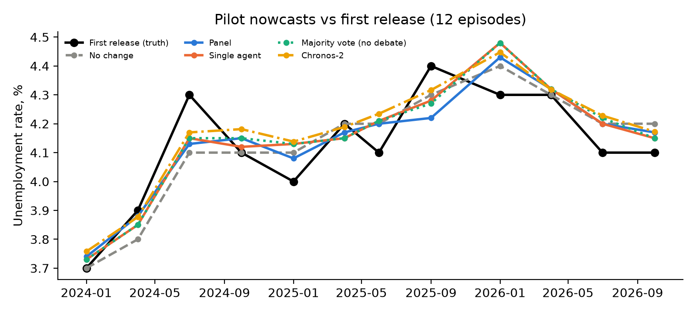

# Milestone II pilot report: 20261124-211538-agents

Episodes: 12 (2024-01, 2024-04, 2024-07, 2024-10, 2025-01, 2025-04, 2025-06, 2025-09, 2026-01, 2026-04, 2026-07, 2026-10).
Final decisions with no usable number (fell back to the last published rate): {'majority_vote': 0, 'panel': 0, 'single_agent': 0}.

## H3: accuracy, intervals and cost (pilot episodes, all systems)

| System | Episodes | MAE | RMSE | 80% coverage | Interval width | Credits | Tokens per forecast |
|---|---|---|---|---|---|---|---|
| No change | 12 | 0.075 | 0.096 | 92% | 0.300 | 0.000 | 0 |
| AR(1) | 12 | 0.075 | 0.092 | 100% | 0.387 | 0.000 | 0 |
| Chronos-2 | 12 | 0.086 | 0.098 | 67% | 0.249 | 0.000 | 0 |
| TimesFM-3 | 12 | 0.088 | 0.102 | 75% | 0.294 | 0.000 | 0 |
| Single agent | 12 | 0.084 | 0.099 | 83% | 0.274 | 4.000 | 2843 |
| Majority vote (no debate) | 12 | 0.089 | 0.103 | 58% | 0.273 | 12.000 | 8188 |
| Panel | 12 | 0.083 | 0.098 | 92% | 0.264 | 3.500 | 9389 |

MAE difference vs no change (negative = better), paired bootstrap 90% CI:

| system | vs | n_shared | mae_diff | ci90_low | ci90_high | share_better |
|---|---|---|---|---|---|---|
| ar1 | no_change | 12 | 0.000 | -0.006 | 0.007 | 0.500 |
| chronos2 | no_change | 12 | 0.011 | -0.013 | 0.032 | 0.333 |
| timesfm3 | no_change | 12 | 0.013 | 0.001 | 0.024 | 0.250 |
| single_agent | no_change | 12 | 0.009 | -0.010 | 0.028 | 0.250 |
| majority_vote | no_change | 12 | 0.014 | -0.005 | 0.033 | 0.250 |
| panel | no_change | 12 | 0.007 | -0.013 | 0.028 | 0.333 |

## H1: faithfulness, every evidence item

| System | Episodes | Cited items | Mean influence, cited | Mean influence, uncited | Cited items that moved the forecast | Moved it in the claimed direction | Rank agreement |
|---|---|---|---|---|---|---|---|
| Single agent | 12 | 56 | 0.023 | 0.035 | 18% | 10% | 0.369 |
| Panel | 12 | 36 | 0.008 | 0.007 | 0% |  | 0.082 |

## H1: faithfulness, purchased evidence only (unemployment history left out)

| System | Episodes | Cited items | Mean influence, cited | Mean influence, uncited | Cited items that moved the forecast | Moved it in the claimed direction | Rank agreement |
|---|---|---|---|---|---|---|---|
| Single agent | 12 | 48 | 0.025 |  | 19% | 11% | 0.469 |
| Panel | 12 | 29 | 0.008 | 0.006 | 0% |  | 0.093 |

Group removal (all labor-market series at once):

| system | condition | episodes | cited_items | uncited_items | cited_influence | uncited_influence | cited_moved_share | uncited_moved_share | direction_agreement | rank_agreement |
|---|---|---|---|---|---|---|---|---|---|---|
| panel | remove_group | 6 | 3 | 3 | 0.007 | 0.002 | 0.000 | 0.000 |  |  |
| single_agent | remove_group | 12 | 12 | 0 | 0.017 |  | 0.000 |  |  |  |

## Qualitative example

### Panel, forecast date 2024-01-20 (target January 2024)
Chosen because it shows a cited item whose removal did not move the forecast.

- Final forecast: 3.74 (80% interval 3.64 to 3.86); evidence bought: CHRONOS2, TIMESFM3, PAYEMS; credits 3
- Chair's explanation: "Based on the steady trend in the unemployment rate over the past year and the slight increase indicated by both time-series models, the forecast is for a slight increase of around 0.1-0.2 percentage points in the unemployment rate. The nonfarm payroll employment data also suggests a steady labor market, with a 3-month average gain of +165k jobs."
- Cited: 1. TIMESFM3 (up), 2. CHRONOS2 (up), 3. UNRATE (up)
- Economist (final round): 3.73 — The forecast is based on the steady trend in the unemployment rate over the past year, with both time-series models indicating a slight increase in January 2024. The nonfarm payroll employment data also suggests a steady labor market, with a 3-month average gain of +165k jobs. As such, the forecast is for a slight increase of around 0.1-0.2 percentage points in the unemployment rate.
- Skeptic: The forecast relies heavily on the steady trend in the unemployment rate, but the recent slowdown in payroll employment growth (+105k in October and +105k in November) suggests that the labor market may be weakening, which could lead to a higher unemployment rate than forecast.

| Condition | Item | Cited | Claimed direction | Forecast without it | Influence (pp) |
|---|---|---|---|---|---|
| remove | UNRATE | yes | up | 3.77 | -0.017 |
| remove | CHRONOS2 | yes | up | 3.75 | +0.003 |
| remove | TIMESFM3 | yes | up | 3.78 | -0.033 |
| remove | PAYEMS | no | nan | 3.74 | +0.013 |

